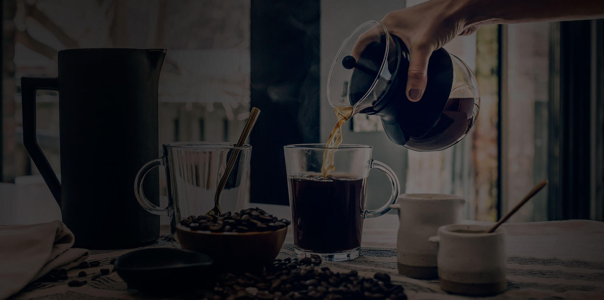

  
  <h1>BlogDeCafé</h1>
  <blockquote>Aprende a preparar mejor café en casa.</blockquote>
  
Blog de guías y recetas de café para principiantes y aficionados, creado con HTML5, CSS3, JavaScript y desplegado con Nginx.

  
<a href="https://blogdecafe.criswebserver.site/">Ver Demo</a> • <a href="https://github.com/CrisLorenzo07/Blog_de_Cafe">Ver Código</a>

## Descripción

BlogDeCafé es un sitio web dedicado al café de especialidad en casa, pensado para quienes están empezando o quieren mejorar su taza diaria. Ofrece explicaciones sencillas para elegir granos, entender la molienda, probar diferentes métodos de preparación y cocinar recetas fáciles de café. Está dirigido a principiantes y aficionados que buscan contenido claro, práctico y sin tecnicismos innecesarios.

El proyecto resuelve la necesidad de tener guías prácticas, recetas con cantidades y pasos detallados, y cursos de formación sobre extracción de café, todo en un solo lugar. Cada sección está diseñada para acompañar al lector desde el grano hasta la taza, con una experiencia visual ordenada y accesible desde cualquier dispositivo.

## Características Principales

### ☕ Artículos y guías
- Guía para elegir granos de café y leer etiquetas
- Técnicas de extracción y ajustes de molienda para cafeteras de casa
- Recetas de café fáciles con cantidades y pasos para principiantes

### 📚 Cursos y talleres
- Catálogo de cursos de formación sobre café
- Fichas detalladas con imagen, resumen y estado de cada curso
- Formulario de consulta para cada curso

### 📅 Calendario y contacto
- Calendario editorial con más guías de café
- Formulario de contacto con validación y estados de envío
- Página de nosotros con presentación del proyecto

## Tecnologías

  
  
  
  

## Vista Previa de la Interfaz

  

---

*Creado con ❤️ por CL - Desarrollo Web*
